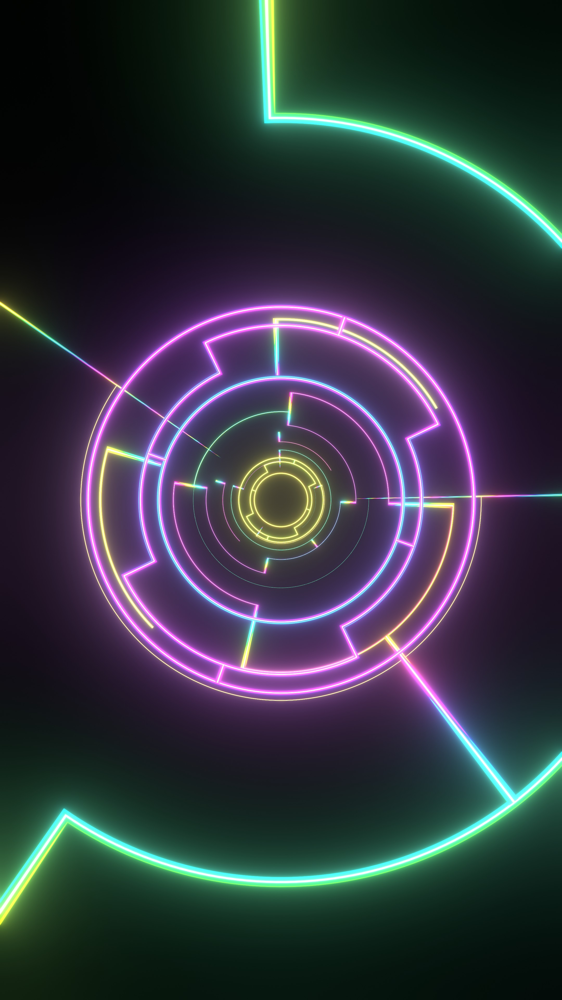
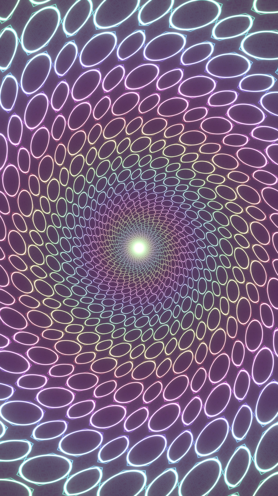

# Audio tunnel (Blender)

Audio-reactive neon tunnel for vertical 9:16 video (2160x3840, 60 fps). Load any mp3 / wav / flac and the
tunnel reacts to kick, bass, loudness, hi-hats, mids and treble. It plays live in the viewport, synced to the music.

  
  

## Files

- `neon_tunnel_audio.blend`: the scene (Blender 5.2). Opens on the **Neon Live** workspace.
- `neon_audio.py`: everything behind it (audio analysis, drivers, kaleidoscope shader, lines-tunnel
  generator, the **Neon** sidebar panel). It is the same code as the `neon_audio.py` text block inside the
  .blend, which registers itself when the file opens.
- `preview_*.jpg`: full-resolution stills of the two looks.

## Use

1. Open the .blend and click **Allow Execution** in the yellow bar (registers the panel).
2. 3D viewport sidebar (**N**) > **Neon** tab.
3. **Music**: *Choose audio file...* (the most dynamic section is picked automatically), or set Start / Length
   and press *Apply music*.
4. **Look & presets**: Lines / Kaleido / Both, presets, *Randomize*, *Save look*. All sliders are live.
5. **Space** plays with sound. *Live view* resets the view if you get lost.

## Export

Output properties > Format > resolution %: 25 % = 540x960 preview, 100 % = 2160x3840 iPhone.
Output is MP4 (H.264 + AAC audio) into `//audio/`. Render > Render Animation (Ctrl+F12).
The video length is Music > Length.

## How it works

- The audio is decoded with Blender's `aud` module and analysed with an STFT at 60 fps into per-frame signals:
  kick (onset peaks 35-120 Hz), bass, loudness, hi-hats (6-16 kHz flux), mids (1-4 kHz flux) and brightness
  (spectral centroid). They are baked as F-curves on the `AudioSignals` empty, plus running sums for motion.
- Every reaction is a driver with a simple expression (no Python auto-run needed) that mixes those signals with
  the sliders, which are custom properties on the `NeonControls` empty.
- Kaleido look: one emission shader on a camera-parented plane. Log-polar tunnel mapping, N-fold mirror,
  four fractal fold layers, and a mix of line / hexagon / circle / dot / circuit distance fields with neon glow.
- Lines look: neon ribbon geometry generated in Python, coloured by depth in the shader.

No audio is included; the scene points to a local file. Audio files are ignored by git.
